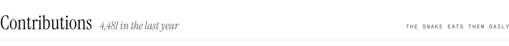

<!-- Generated by personal-site/profile/build_profile.py. Edit the script, not this file. -->

<picture><source media="(prefers-color-scheme: dark) and (max-width: 600px)" srcset="assets/hero-mobile-dark.svg"><source media="(max-width: 600px)" srcset="assets/hero-mobile-light.svg"><source media="(prefers-color-scheme: dark)" srcset="assets/hero-dark.svg"></picture>

<picture><source media="(prefers-color-scheme: dark) and (max-width: 600px)" srcset="assets/nastya-work-mobile-dark.svg"><source media="(max-width: 600px)" srcset="assets/nastya-work-mobile-light.svg"><source media="(prefers-color-scheme: dark)" srcset="assets/nastya-work-dark.svg"></picture>

<samp><a href="https://ois.gold">ois.gold</a> · happyin · happyin auto · ois.blue · margins.club · <a href="https://diffusion.love">diffusion.love</a></samp>

<picture><source media="(prefers-color-scheme: dark)" srcset="assets/stack-dark.svg"></picture>

<picture><source media="(prefers-color-scheme: dark)" srcset="assets/contrib-dark.svg"></picture>

<picture>
  <source media="(prefers-color-scheme: dark)" srcset="https://raw.githubusercontent.com/Anastasiya1551/Anastasiya1551/output/snake-dark.svg">
  
</picture>

<samp><a href="https://www.linkedin.com/in/anastasiya-ilukhina-09646a289/">linkedin</a> · <a href="https://t.me/Anastasia_Iluhina">telegram</a> · <a href="mailto:navok.1.3@gmail.com">navok.1.3@gmail.com</a></samp>

